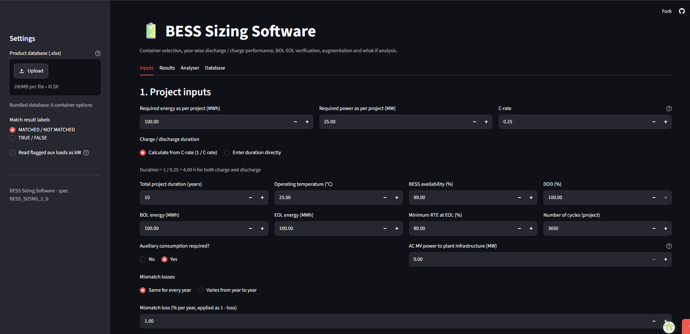
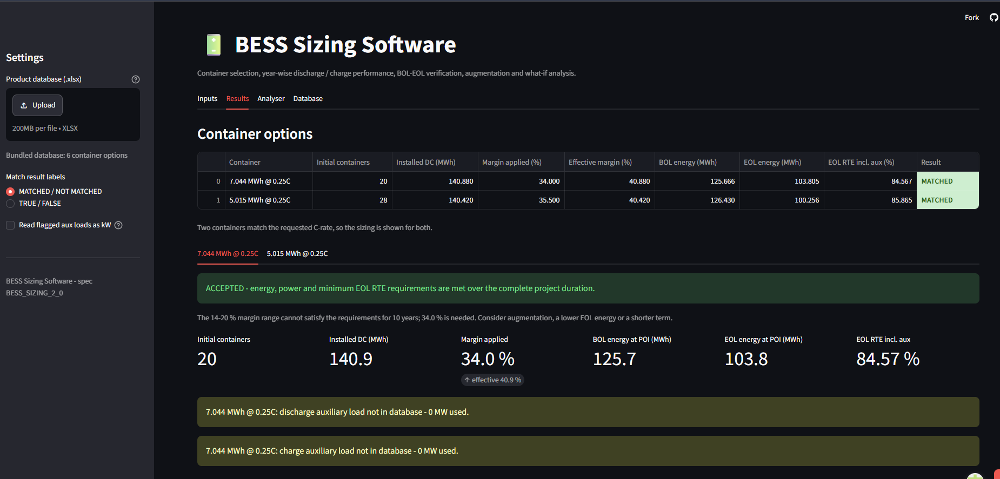

## BESS Sizing & Performance Analysis Software

<p align="center">
  <a href="https://bess-sizing-web.streamlit.app/">
    
  </a>
</p>

<p align="center">
  <a href="https://bess-sizing-web.streamlit.app/"><strong>🌐 Launch Live Application</strong></a>
  &nbsp; • &nbsp;
  <a href="https://github.com/venkat24-dev/bess-deomonstartion-repo"><strong>💻 View Source Code</strong></a>
</p>

---

## 📸 Application Preview

Explore the main screens of the BESS sizing application, from engineering inputs to sizing results and performance verification.

<table>
  <tr>
    <td align="center" width="50%">
      <strong>⚙️ 1. Project Inputs</strong><br><br>
      <a href="https://github.com/venkat24-dev/bess-deomonstartion-repo/blob/526f11a4e2e4ffa99b74b76da93810785b337e95/bess%20inputs%20ui.png">
        
      </a><br>
      <sub>Configure project requirements, battery parameters, and supported operating assumptions.</sub>
    </td>
    <td align="center" width="50%">
      <strong>📊 2. Sizing Results</strong><br><br>
      <a href="https://github.com/venkat24-dev/bess-deomonstartion-repo/blob/526f11a4e2e4ffa99b74b76da93810785b337e95/bess%20results%20ui.png">
        
      </a><br>
      <sub>Review calculated sizing outputs and supported performance verification results.</sub>
    </td>
  </tr>
</table>

<p align="center">
  <a href="https://bess-sizing-web.streamlit.app/"><strong>▶ Try the Interactive Application</strong></a>
</p>

---

## 🔗 Project Links

- **Live Application:** https://bess-sizing-web.streamlit.app/
- **GitHub Repository:** https://github.com/venkat24-dev/bess-deomonstartion-repo


## Overview

This application helps users assess BESS configurations using battery-container specifications, project energy and power requirements, operating assumptions, efficiency parameters, and battery degradation.

It combines engineering calculations with interactive analysis to compare sizing scenarios and evaluate whether a proposed configuration satisfies supported project requirements throughout its operating lifetime.

## Key Features

- **Battery Sizing:** Estimate the number of battery containers required based on energy, power, and C-rate constraints.
- **BOL and EOL Verification:** Evaluate beginning-of-life (BOL) and end-of-life (EOL) energy performance.
- **Lifetime Analysis:** Assess degradation and verify supported energy, power, and round-trip efficiency (RTE) requirements across project years.
- **What-If Analysis:** Explore how changes in engineering assumptions affect sizing and performance.
- **Operating Parameters:** Configure supported parameters such as availability, depth of discharge (DOD), mismatch losses, and auxiliary consumption.
- **Augmentation Analysis:** Evaluate supported battery augmentation scenarios over the project lifetime.
- **Interactive Results:** Review calculation outputs, comparison tables, and engineering explanations.
- **Excel Reporting:** Export available calculation results for further analysis and documentation.
- **Battery Catalog:** Use an Excel-based battery-container catalog to support sizing calculations.

## Live Demo

**Try the application:** https://bess-sizing-web.streamlit.app/

1. Open the live application.
2. Configure project energy and power requirements.
3. Select the available battery container and operating parameters.
4. Review sizing results and lifetime performance verification.
5. Explore what-if scenarios and download the available report.

## Technology Stack

- **Programming:** Python
- **Application and UI:** Streamlit
- **Data Processing:** Pandas, NumPy
- **Data Source and Reporting:** Excel
- **Database Foundation:** PostgreSQL, SQLAlchemy
- **API Foundation:** FastAPI
- **Testing:** Pytest
- **Database Migrations:** Alembic

**Architecture note:** The deployed Streamlit application currently runs as a standalone, Excel-backed sizing calculator. The repository also contains separate FastAPI and PostgreSQL components, but the deployed UI is not yet integrated with that backend.

## Project Structure

| Component | Purpose |
|---|---|
| `app.py` | Streamlit application and user interface |
| `bess/engine.py` | Sizing calculations, yearly calculations, and performance verification |
| `bess/database.py` | Loads the Excel battery catalog |
| `bess/analyser.py` | What-if analysis and engineering explanations |
| `bess/report.py` | Excel report generation |
| `api.py` | Separate REST API |
| `bess/models/` | Database models |
| `bess/db_connection.py` | Database connection foundation |
| `alembic/` | Database migration configuration |
| `tests/` | Automated tests |
| `data/BESS_DATABASE.xlsx` | Battery-container catalog |

## Engineering and Validation

The sizing workflow evaluates container requirements and checks supported project constraints over the operating lifetime.

Depending on the selected configuration and available catalog data, the calculations account for:

- Battery-container energy and power specifications
- Availability and depth of discharge
- Round-trip efficiency and conversion losses
- Battery state of health and degradation
- Auxiliary consumption and mismatch losses
- Year-by-year performance requirements
- Supported augmentation scenarios

The repository includes automated tests for sizing calculations. API and PostgreSQL integration tests have separate configuration requirements.

**Important limitation:** The API does not support every input and analysis option available in the Streamlit interface. Its calculation coverage is limited to the inputs represented in the API request contract.

## Local Setup

### Prerequisites

- Python installed
- Git installed
- The project repository and Excel battery catalog available locally

### 1. Clone the repository

```bash
git clone https://github.com/venkat24-dev/bess-deomonstartion-repo.git
cd bess-deomonstartion-repo
```

### 2. Install dependencies

```bash
pip install -r requirements.txt
```

### 3. Run the Streamlit application

```bash
streamlit run app.py
```

The Excel battery catalog must be available at:

```text
data/BESS_DATABASE.xlsx
```

## API and PostgreSQL Foundation

The repository contains a separate REST API and PostgreSQL persistence foundation for project management and sizing requests.

The API uses database configuration through `DATABASE_URL` and requires configured OpenID Connect (OIDC) bearer-token authentication for protected project and sizing endpoints. Database migrations must be applied before using the database-backed functionality.

To start the API locally after configuring the required environment and database:

```bash
uvicorn api:app --host 127.0.0.1 --port 8000
```

The API requires OIDC bearer-token authentication for project and sizing endpoints.
Configure `OIDC_ISSUER`, `OIDC_AUDIENCE`, and `OIDC_JWKS_URL` using values supplied by
your trusted identity provider. Tokens are verified with RS256, issuer and audience
validation, required `iss`/`sub`/`aud`/`exp`/`iat` claims, and a short clock-skew allowance.
The corresponding `(issuer, subject)` user must already exist and be active in
`bess.users`; user provisioning is an administrative operation and is not performed from
untrusted token claims. There is no development authentication bypass. Protected routes
fail closed if OIDC settings are missing or invalid.

Project access is controlled by existing organization and project memberships. Only
organization owners/admins can create projects. Project owners/editors can update projects
and submit project simulations; only project owners can add active members who already
belong to the same organization. Project viewers can retrieve results but cannot submit or
modify projects. Projectless sizing requests remain supported for compatibility and are
owned by the authenticated creator. The API does not expose project or simulation data to
unauthenticated callers.

The API is not yet a complete production identity lifecycle: configure TLS at the trusted
deployment edge, provision and deactivate users through an administrative process, and
review provider-specific key-rotation and operational monitoring before exposure. It provides:

* `GET /health` - confirms PostgreSQL connectivity.
* `GET /api/v1/containers` - lists container options from the bundled workbook.
* `GET /api/v1/catalog/manifest` - returns the bundled workbook SHA-256 and available container metadata.
* `POST /api/v1/projects` - creates a project in an organization where the caller is owner/admin.
* `GET /api/v1/projects` and `GET /api/v1/projects/{project_id}` - list/retrieve projects where the caller is a member.
* `PATCH /api/v1/projects/{project_id}` - update a project as owner/editor.
* `POST /api/v1/projects/{project_id}/members` - add an organization member as a project owner.
* `POST /api/v1/sizing` - validates a sizing request, calculates results, and persists them. An optional `project_id` associates it with an authorized project.
* `GET /api/v1/sizing/{request_id}` - retrieves a saved run only for its creator or an authorized project member.

The Streamlit application is currently a standalone Excel-backed calculator; it does not
call FastAPI, and its existing calculations, charts, analyser, and report download remain
the default workflow. `bess/api_client.py` defines a separate authenticated HTTP boundary
for a future integration but is not wired into `app.py`. A future Streamlit integration
must obtain L&T-approved SSO configuration first and pass a short-lived **API access token
for the signed-in user** to that client per request. Do not use a shared service token,
place tokens in environment variables, accept identity from untrusted headers, or send an
OIDC ID token unless the identity team explicitly confirms it is also an API access token
with this API as its audience. The client requires HTTPS outside loopback development,
does not follow redirects, applies a timeout, and avoids echoing backend error bodies.
Server-side HTTP calls do not require browser CORS; if deployment changes to browser-direct
API calls, configure a narrow explicit CORS allow-list instead of permissive origins.

### Sizing input coverage (not a UI integration)

The API sizing request rejects unrecognized fields. This prevents unsupported UI settings
from being silently accepted as if they affected the calculation. The table describes the
current Streamlit sizing controls and the existing `POST /api/v1/sizing` request contract;
it does not enable API mode.

| Streamlit control | API representation |
| --- | --- |
| Required project energy, required power, C-rate | `required_energy_mwh`, `required_power_mw`, `c_rate` |
| Duration from C-rate | Implicit in API calculation using C-rate |
| Manual charge/discharge duration and separate times | Not represented |
| Project years, operating temperature, availability, DOD | `project_years`, `operating_temp_c`, `availability_pct`, `dod_pct` |
| BOL/EOL energy, minimum EOL RTE, cycles | `bol_energy_mwh`, `eol_energy_mwh`, `min_rte_eol_pct`, `cycles_required` |
| Auxiliary consumption enabled | `aux_required` |
| Plant infrastructure power | Not represented |
| Constant mismatch loss | `mismatch_constant_pct` |
| Year-varying mismatch loss and yearly required energy/RTE/power tables | Not represented |
| Automatic nearest-C-rate selection or manual multi-container selection | Not represented; API requires one exact `container_id` |
| Minimum/maximum margin, fixed container count, extended margin search | `margin_min_pct`, `margin_max_pct`, `manual_containers`, `allow_extended_margin` |
| Main transformer source, AC/auxiliary overrides, auxiliary kW correction | Not represented |
| Extra auxiliary and standby toggles, values, source and booking side | Not represented |
| FAT/SAT toggle, duration and manually entered monthly degradation | Not represented |
| Augmentation toggle, event table and SOH age basis | Not represented |
| Workbook upload | Not represented; API uses its own bundled workbook |
| Result-label style, analyser controls, Claude narration, Excel report download | Presentation/analysis features; not represented by sizing request |

Sizing requests continue to use the bundled Excel catalog. Persisted snapshots include the
resolved engine inputs, selected container data, workbook SHA-256, engine source hash,
application/runtime versions, calculation output, and engine warnings. An optional
`Idempotency-Key` request header prevents accidental duplicate submissions.
Successful sizing responses retain their existing fields and add `effective_inputs`,
`catalog_sha256` for the exact bundled workbook bytes used, and `warnings`. Every yearly
record includes an explicit `Year` value. These additions do not provide the full local
container/result objects required by the Streamlit analyser or Excel report.

Before submitting sizing, clients must retrieve `GET /api/v1/catalog/manifest` and send
its `catalog_sha256` value as the required `catalog_sha256` field in `POST /api/v1/sizing`.
The manifest response contains `schema_version` (`catalog-manifest-v1`), the lowercase
64-character SHA-256 digest, `container_ids`, and `containers` with the same metadata
fields as `GET /api/v1/containers`. The sizing endpoint reads one workbook snapshot,
compares the submitted digest to that snapshot, and calculates from the same parsed
snapshot. A stale or mismatched digest returns HTTP 409 with
`detail.code = "catalog_mismatch"`; retrieve the manifest and retry. Missing or malformed
digests return HTTP 422. The digest is a consistency precondition, not an authentication
mechanism. `BESSAPIClient.get_catalog_manifest()` validates the manifest contract; pass
the returned digest to `submit_sizing(..., catalog_sha256=...)`. Older sizing clients must
be updated because requests without the precondition are intentionally rejected.

Demonstrated calculation parity is limited to database-free tests of supported API inputs
against `size_container()` using identical workbook bytes. It does not demonstrate parity
for Streamlit controls absent from the API request schema, the analyser, or Excel report
generation. User-uploaded Streamlit workbooks remain local-only and are not sent to the
API or treated as equivalent to the server catalog. Streamlit API integration and company
SSO/token delivery are not enabled.

Example request:

```json
{
  "container_id": "5.015MWh_0.25C",
  "catalog_sha256": "<64-character digest from the catalog manifest>",
  "required_energy_mwh": 100,
  "required_power_mw": 20,
  "project_years": 10
}
```

For client code, retrieve the manifest before submitting:

```python
manifest = client.get_catalog_manifest()
result = client.submit_sizing(
    request,
    catalog_sha256=manifest["catalog_sha256"],
)
```

Never commit `DATABASE_URL`; set it in the process environment or your deployment's secret
manager. Set the three OIDC values in the process environment or local `.env`; do not
invent provider values or commit production settings. Run the API tests with
`pytest -q tests/test_api.py`.

PostgreSQL simulation integration tests are marked `postgres` and use only the explicitly
configured `BESS_SIMULATION_TEST_DATABASE_URL`; they never fall back to `DATABASE_URL`.
The target must be a dedicated database whose name includes `test`, must differ from the
application database, and must already be at Alembic revision `20261012_0003`. Tests do not
create schemas or apply migrations automatically. Run them with
`pytest -q -m postgres`; set `BESS_REQUIRE_POSTGRES_TESTS=1` to fail instead of reporting
the integration check as blocked when the dedicated target is unavailable. Catalog
PostgreSQL tests use the separate `BESS_CATALOG_TEST_DATABASE_URL` setting and can be
required with `BESS_REQUIRE_CATALOG_TESTS=1`.

## PostgreSQL catalog foundation

The SQLAlchemy connection layer reads `DATABASE_URL` from the process environment, or from
the local `.env` file when first used. A suitable URL form is shown in `.env.example`.
Percent-encode reserved characters in URL credentials; do not put real credentials in
`.env.example` or source control. The recommended deployment account is a least-privilege
application role, not the PostgreSQL superuser.

Foundational ORM models and Alembic configuration live in `bess/models/`, `bess/db_connection.py`
and `alembic/`. Revisions `20261012_0001` through `20261012_0003` create the foundational,
catalog-detail, and simulation-persistence structures in the `bess` schema. The versioned workbook catalog importer is in `bess/catalog_import.py`; it reads the
existing Excel parser output, validates the source SHA-256 and engineering data, persists
complete revisions transactionally, and never activates a revision during import.

Run a read-only catalog validation with:

```bash
python -c "from bess.catalog_import import dry_run_catalog; print(dry_run_catalog('data/BESS_DATABASE.xlsx'))"
```

Import and activation are separate service operations; activation must be explicitly requested
with `activate_catalog_revision`. The PostgreSQL catalog is not used by the sizing engine or
API; the Excel-based loading path remains in effect.

## Deploy on Streamlit Community Cloud

1. Push this folder to a GitHub repository (keep `data/BESS_DATABASE.xlsx` in the repo).
2. On <https://share.streamlit.io> choose **New app**, select the repository and set the main file to `app.py`.
3. Optional (Claude narration in the Analyser): in *Advanced settings -> Secrets* add
   `ANTHROPIC_API_KEY = "sk-ant-..."`. Without it the analyser uses its built-in rule-based explanations.

## Repository layout

| Path | Purpose |
|---|---|
| `app.py` | Streamlit UI: Inputs, Results, Analyser, Database tabs |
| `bess/database.py` | Reads the Excel database (finds each table by its label, so sheet layouts may differ) |
| `bess/engine.py` | All sizing formulas, year-wise calculation, verification, margin search |
| `bess/analyser.py` | What-if comparison, free-text parser, engineering explanations, optional Claude |
| `bess/report.py` | Excel export |
| `tests/test_bess.py` | `pytest -q` (formulas checked against hand calculations) |

To change the database, replace `data/BESS_DATABASE.xlsx` (same sheet structure) or upload a new file from the sidebar.

## Future Improvements

Potential next steps include:

- Integrating the Streamlit interface with the authenticated API
- Connecting the sizing workflow to a versioned PostgreSQL catalog
- Expanding automated tests for engineering calculations and edge cases
- Improving deployment monitoring and operational documentation
- Extending API input coverage to match additional supported UI controls

These are potential improvements, not claims of already completed functionality.

---


